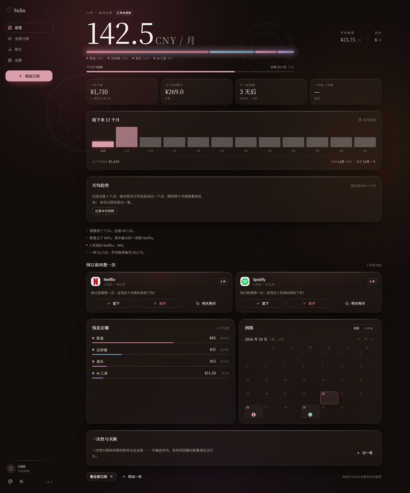
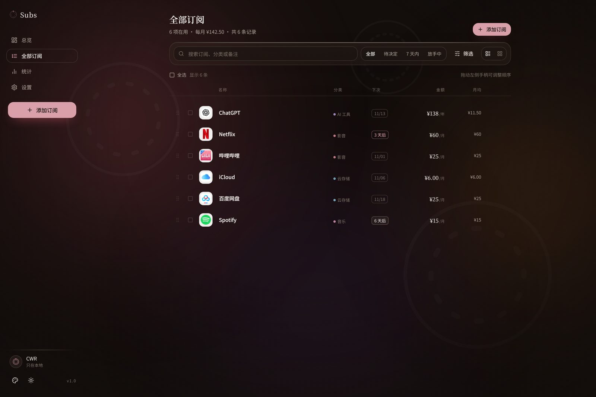
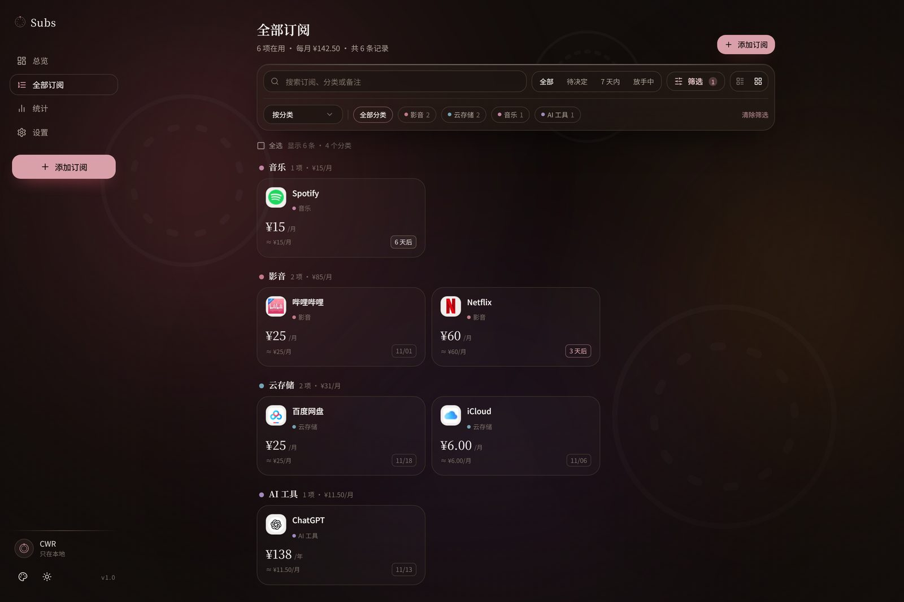

# Subs

**把订阅理清，把选择留给自己。**

本地优先的订阅管理与续费决策应用。记下会员、创作者充电、AI 套餐，之后每月花了多少、花在哪、下一次要付什么，一眼看清；每次续费前它只问你一句「还要不要」，决定留给你自己。

没有账号、没有后端、不上传任何记录 —— 数据只存在你的浏览器里。

<p align="center">
  
</p>

<p align="center">
  <a href="#功能">功能</a> ·
  <a href="#快速开始">快速开始</a> ·
  <a href="#docker">Docker</a> ·
  <a href="#设计">设计</a> ·
  <a href="#隐私">隐私</a>
</p>

---

## 功能

### 总览
本月花费大数字 · 构成条与图例 · 平均每项 / 在付项数 · 四格指标（一年下来 / 30 天内要付 / 下一次扣款 / 一次性累计）· **接下来 12 个月的实际扣款分布** · **月均趋势（环比）** · 自动洞察 · 预算进度 · 到期日历 / 时间轴 · 一次性与买断。

### 续费决策
到期前提醒，三个选项：**留下 / 放手 / 明天再问**。每次决定都会留痕，统计页会把它算成「放手一年省下多少」。

### 全部订阅（管理台）
账本式列表与卡片双视图 · 按到期日 / 月均金额 / 分类 / 名称排序 · 手动拖拽排序 · 状态与分类筛选 · 多选批量操作（放手 / 恢复 / 改分类 / 删除）。

### 统计
周期结构（月付 / 季付 / 年付各占多少）· 决策结果与节省估算 · 单项金额分布 · 最贵几项排行 · 费用快照表（含环比增减，可导出 CSV）· 订阅 CSV 导出。

### 添加订阅
40 个内置预设，**每个都带真实品牌图标**（构建时抓取并打包在 `public/presets/`，离线可用）；也可以联网取官网图标、上传自己的图片，或退回品牌色块 + 衬线首字母。

### 设置
明暗（夜里 / 白天）· 四种强调色（藕粉 / 藤紫 / 秋香 / 灰绿）· 昵称与头像 · 汇总币种与汇率（Frankfurter）· 每月预算 · 提醒提前天数 · 数据概况 · 导出 / 导入 JSON · 恢复内置名单。

<p align="center">
  
</p>

---

## 快速开始

```bash
npm install
npm run dev        # http://localhost:5273
npm run build      # 产出 dist/
npm run preview    # 预览产物
npm run typecheck  # 类型检查
```

需要 Node 20+（开发用 22）。

---

## Docker

镜像地址：`<dockerhub-user>/subs`（由 CI 自动构建推送，见下文）

```bash
docker run -d --name subs -p 5273:8080 --restart unless-stopped \
  -e TZ=Asia/Shanghai <dockerhub-user>/subs:latest
```

打开 `http://<host>:5273`。

或用 compose 本地构建：

```bash
docker compose up -d --build
```

### 说明

- 镜像**多阶段构建**：`node:22-alpine` 里构建，产物拷进 `nginx:1.27-alpine`，最终镜像不含源码与 node_modules。
- 容器内**非 root** 运行（`USER nginx`），监听 **8080**，对外由 `-p` 映射。
- 自带 `HEALTHCHECK`（`GET /healthz`），**无常驻进程、无数据库、无数据卷**。
- 带指纹的资源 `Cache-Control: immutable`，`index.html` 不缓存，发版即时生效。
- 构建参数 `NPM_REGISTRY` 可切 npm 源（默认 npmmirror，CI 用官方源）。

### 发布镜像

推送 `v*.*.*` 标签时，GitHub Actions 会自动构建 `linux/amd64` + `linux/arm64` 双架构镜像并推送到 Docker Hub：

```bash
git tag v1.0.0 && git push origin v1.0.0
```

需要在仓库的 **Settings → Secrets and variables → Actions** 里配置：

| Secret | 说明 |
| --- | --- |
| `DOCKERHUB_USERNAME` | Docker Hub 用户名 |
| `DOCKERHUB_TOKEN` | Docker Hub Access Token（不要用登录密码） |

### 放到反代后面

纯静态站点，不需要 WebSocket、不需要 TLS 终结。把 `https://subs.example.com` 反代到 `http://<host>:5273` 即可。

---

## 设计

**刻度环**：订阅的本质是周期 —— 一圈刻度，一个标出当前位置的点。它出现在品牌标记、头像与背景里（几圈缓慢转动的细环）。

暖调、低饱和。背景是三团缓慢漂移的暖色光晕加细尘，玻璃才有东西可透 —— 卡片只用一圈发丝高光和一层柔光，不叠机械阴影。数字用衬线（衬线大字号 + 紧字距），正文用无衬线；每项订阅配一个小色块和衬线斜体首字母。

<p align="center">
  
</p>

## 技术栈

| 层 | 选择 |
| --- | --- |
| 框架 | React 18 + TypeScript + Vite 6 |
| 样式 | Tailwind CSS 3 + 自建 shadcn 风格组件（构建在 **Radix UI** 之上） |
| 状态 | **Zustand**（含 persist，localStorage） |
| 动效 | **Motion** |
| 图标 | **Lucide React** |
| 数据请求 | **TanStack Query**（汇率 / 图标，按需触发） |
| 图表 | **Recharts**（统计页懒加载，不占首屏） |
| 拖拽 | **dnd-kit** |
| 部署 | 多阶段 Dockerfile + nginx |

首屏约 **210 KB gzip**，图表库单独切成 113 KB 的 chunk，只在统计页加载。

## 目录结构

```
src/
  components/
    ui.tsx                    # shadcn 风格原语（Button/Input/Dialog/Select/…，基于 Radix）
    ambient.tsx               # 刻度环、暖光、玻璃卡、衬线大数字、服务图标
    AppShell.tsx              # 桌面侧栏 + 手机底栏 + 外观控制
    pieces.tsx                # 构成条、分类列表、时间轴、决策卡
    TrendLine.tsx             # 月均趋势（纯 SVG，无图表库）
    RenewalCalendar.tsx       # 到期日历（月视图）
    AddSubscriptionDialog.tsx
  pages/                      # 总览 / 全部订阅 / 统计 / 设置 / 落地页与引导
  lib/                        # 类型、金额折算、日期、预设目录、汇率、洞察、报告
  store/useSubsStore.ts       # Zustand + persist
scripts/
  fetch-preset-icons.cjs      # 构建时抓取预设品牌图标
```

## 隐私

- 记录存在 `localStorage` 的 `subs.state.v1`，汇率缓存 `subs.fx.v1`。
- 只有两个外部请求，且都由你点按钮触发：
  - `https://api.frankfurter.dev` —— 取公开汇率，**只发送币种代码**
  - `https://icon.horse` —— 取官网图标，只发送你填的域名
- 页面用 `<meta>` 声明了较严的 CSP：`default-src 'self'`，`connect-src` 仅放行上述两个域，`frame-src` / `object-src` 全禁。
- 换设备或清浏览器数据前，请在 **设置 → 导出** 存一份 JSON。

## 贡献

```bash
git clone https://github.com/Caoran1314/subs.git
cd subs && npm install
npm run dev
```

提交前请确保 `npm run typecheck && npm run build` 通过（CI 也会跑）。

## 许可

[MIT](LICENSE)
